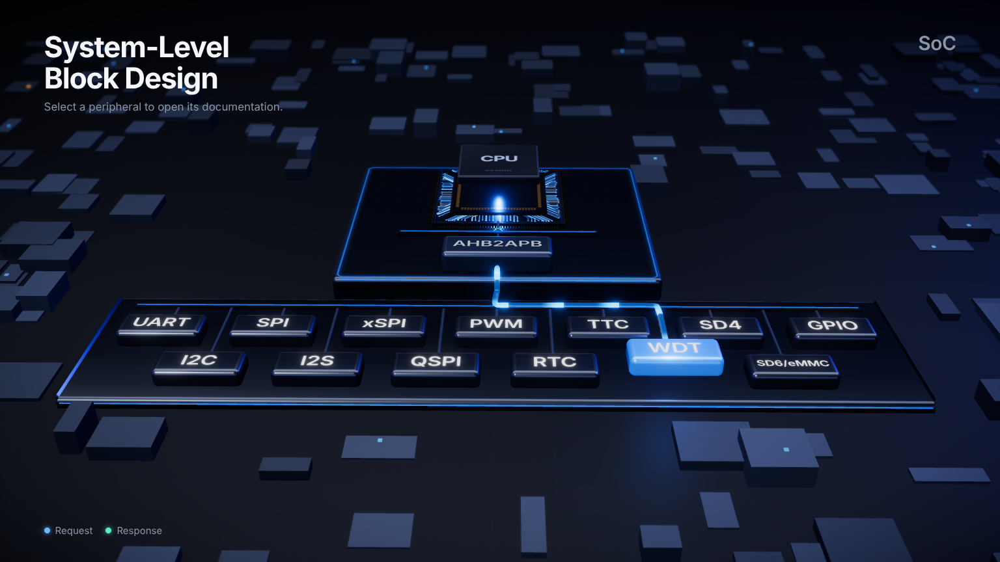

# System-Level Block Design

An interactive 3D block diagram of an SoC. A CPU, drawn as an exploded chip package with a floating
lid, drives an AHB bus on a raised tier. An AHB2APB bridge steps down to the APB tier, and thirteen peripheral IP blocks sit on it: UART,
I2C, SPI, I2S, xSPI, QSPI, PWM, RTC, TTC, WDT, SD4, SD6/eMMC and GPIO. Light travels the wires,
blocks lift when you point at them, and a click flies the camera in. The block's documentation
then opens as a circle that grows out of it.

The layout follows the reference diagram in
[`docs/assets/reference-diagram.jpg`](docs/assets/reference-diagram.jpg), with three
simplifications: a single CPU instead of two, one AHB bus instead of separate master and
slave buses, and no AHBC block between them. The flat 2D version of the same diagram is kept as the fallback.





## Features

- **Height means hierarchy.** The CPU and AHB bus sit on a raised glass tier; the APB bus and
  the peripherals on a lower one. The step between them is lit.
- **The CPU is a chip, not a box.** Substrate with glowing fan-out traces and gold pins, an
  interposer, and a heat-spreader lid that lifts off the package when the scene assembles and then
  floats. It glows blue as it sends a request and as the last answer returns.
- **Electric flow.** An 8-second loop sends light from the CPU down to the peripherals, then
  back. It is a shader on the wires, so it costs one draw call.
- **Lift.** Pointing at a block lifts it on a spring, turns it blue, dims the others, casts a
  blue wash on the tier and lights the route from the bridge to it.
- **Camera.** The scene opens with a dolly in from above while the tiers rise and the blocks
  drop into place. The camera then leans gently toward the pointer. A click flies it over the
  board to the block, and the docs open from there. Esc flies it back.
- Deep links (`/ip/spi`) and browser history work. The camera follows the URL.
- Keyboard and screen-reader access: a visually hidden list of links gives the same choice as
  the scene (press Tab to see it). The 3D canvas itself is hidden from assistive technology.
- Reduce Motion removes the intro, the parallax and the travelling light, and turns flights into
  quick cuts. Quality scales down automatically on slow machines.
- Without WebGL the flat 2D diagram is shown instead, and `?view=2d` forces it.
- All documentation lives in one typed data file.

## Quick start

Requirements: Node.js 22 (the project was built and checked with 22.13), and npm.

```bash
npm install
npm run dev
```

Open the URL that Vite prints (usually http://localhost:5173).

## Scripts

| Command | What it does |
| --- | --- |
| `npm run dev` | Development server with hot reload |
| `npm run build` | Type-check (`tsc -b`) and build the production bundle into `dist/` |
| `npm run preview` | Serve the production build locally, for checking before deployment |
| `npm run lint` | Run oxlint over `src/` |

## Editing the content

All IP documentation is in [`src/data/ips.ts`](src/data/ips.ts). The register
tables, signal lists and descriptions there are **placeholders**. Replace them
with values from your own specifications before publishing.

See [docs/CONTENT_GUIDE.md](docs/CONTENT_GUIDE.md) for the field-by-field reference.

## Documentation

| Document | Contents |
| --- | --- |
| [docs/CONTENT_GUIDE.md](docs/CONTENT_GUIDE.md) | How to write and add IP documentation |
| [docs/ARCHITECTURE.md](docs/ARCHITECTURE.md) | Component map, diagram layout and the open and close transition |
| [docs/DEVELOPMENT.md](docs/DEVELOPMENT.md) | Working on the code: testing, known limitations, troubleshooting |

## Project layout

```
src/
  App.tsx              routes; the diagram stays mounted under the docs
  main.tsx             entry point (BrowserRouter)
  index.css            design tokens and all styles
  data/ips.ts          IP documentation (edit this)
  diagram/layout.ts    2D coordinates for the buses, infrastructure blocks and peripherals
  diagram/flow.ts      the traffic schedule: pulses, timings and arrival times
  lib/motion.ts        reduced-motion and WebGL detection, easing functions
  lib/origin.ts        on-screen position of a block, for the reveal
  pages/
    Landing.tsx        chooses 3D or flat; the 3D stage, the title and the hidden list
    Diagram.tsx        the flat SVG diagram (fallback)
    IpPage.tsx         documentation page and circle reveal
  scene/
    SocScene.tsx       canvas, camera director, lighting, post-processing
    world.ts           the 2D layout stood up in 3D: tiers, heights, wire paths
    Stage.tsx          board, surrounding components, tiers and bus rails
    Block.tsx          a glass block: lift spring, label, shadow and arrival flash
    Chip.tsx           the CPU package: substrate, pins, interposer, floating lid
    pins.ts            instanced pin and pad matrices around a square package
    Wires.tsx          conduits, travelling light and the hover route
    wires.ts           wire geometry and the light shaders
    textures.ts        canvas-generated labels, tier surfaces and board
    state.ts           shared per-frame state and the intro timeline
```

## Deployment

### GitHub Pages

[`.github/workflows/deploy.yml`](.github/workflows/deploy.yml) builds and publishes the
site on every push to `main`. This branch is not published until it is merged there.

Pages serves the site from `/<repository>/`, so the workflow builds with
`VITE_BASE=/<repository>/`. `vite.config.ts` reads that variable as the Vite `base`,
and `main.tsx` passes it to the router, so links and assets resolve under the subpath.
Local development and plain builds are unaffected and stay at `/`. The workflow also
copies `index.html` to `404.html`, so refreshing on `/<repository>/ip/spi` still loads
the app.

To preview a Pages build locally (use the repository name in place of `SoC_Portfolio`):

```bash
VITE_BASE=/SoC_Portfolio/ npm run build
VITE_BASE=/SoC_Portfolio/ npm run preview   # open http://localhost:4173/SoC_Portfolio/
```

On Windows, run those in PowerShell (`$env:VITE_BASE='/SoC_Portfolio/'`). Git Bash
rewrites a value that starts with `/` into a file path, unless you prefix the command
with `MSYS_NO_PATHCONV=1`.

### Other hosts

This is a single-page app with routes such as `/ip/spi`. The host must serve
`index.html` for any path it does not recognise. Otherwise a refresh on `/ip/spi`
returns a 404.

- **Netlify:** add a `public/_redirects` file containing `/* /index.html 200`.
- **Vercel:** works without configuration for Vite apps.

The app shell is about 300 KB (93 KB gzipped). The 3D scene is code-split into its own chunk
(about 1.1 MB, roughly 300 KB gzipped), so the documentation pages and the flat fallback do not
download it. Fonts (Inter and IBM Plex Mono) load from
Google Fonts. On Apple devices the system font (SF Pro) is used first.

## License

No license has been chosen yet. Until one is added, all rights are reserved by the author.
