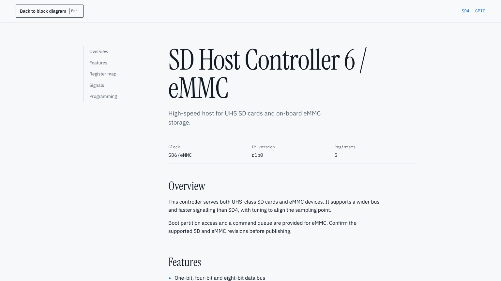

# System-Level Block Design

An interactive 2D block diagram of an SoC. Two CPUs share an AHB bus, an AHB2APB
bridge steps down to the APB bus, and thirteen peripheral IP blocks hang off it:
UART, I2C, SPI, I2S, xSPI, QSPI, PWM, RTC, TTC, WDT, SD4, SD6/eMMC and GPIO. Click a
block and its documentation opens as a circle that grows out of the block, over the
diagram.

The layout follows the reference diagram in
[`docs/assets/reference-diagram.jpg`](docs/assets/reference-diagram.jpg), with two
simplifications: one AHB bus instead of separate master and slave buses, and no AHBC
block between them.




## Features

- One SVG diagram that scales to the screen, so the layout is identical at 1366x768,
  1536x864 and 1920x1080.
- Peripherals alternate between two rows, as in the reference, so thirteen blocks fit on
  one bus.
- Hover or keyboard focus turns a block and its bus arrow blue.
- A clip-path reveal that starts from the clicked block. Esc or the back button reverses it.
- Deep links (`/ip/spi`) and browser history work.
- Keyboard and screen-reader access: every peripheral is a real link with its summary as
  its label, and focus returns to the block when the docs close.
- Reduced-motion support.
- All documentation lives in one typed data file.

## Quick start

Requirements: Node.js 22 (the project was built and checked with 22.13), and npm.

```bash
npm install
npm run dev
```

Open the URL that Vite prints (usually http://localhost:5173).

## Scripts

| Command | What it does |
| --- | --- |
| `npm run dev` | Development server with hot reload |
| `npm run build` | Type-check (`tsc -b`) and build the production bundle into `dist/` |
| `npm run preview` | Serve the production build locally, for checking before deployment |
| `npm run lint` | Run oxlint over `src/` |

## Editing the content

All IP documentation is in [`src/data/ips.ts`](src/data/ips.ts). The register
tables, signal lists and descriptions there are **placeholders**. Replace them
with values from your own specifications before publishing.

See [docs/CONTENT_GUIDE.md](docs/CONTENT_GUIDE.md) for the field-by-field reference.

## Documentation

| Document | Contents |
| --- | --- |
| [docs/CONTENT_GUIDE.md](docs/CONTENT_GUIDE.md) | How to write and add IP documentation |
| [docs/ARCHITECTURE.md](docs/ARCHITECTURE.md) | Component map, diagram layout and the open and close transition |
| [docs/DEVELOPMENT.md](docs/DEVELOPMENT.md) | Working on the code: testing, known limitations, troubleshooting |

## Project layout

```
src/
  App.tsx              routes; the diagram stays mounted under the docs
  main.tsx             entry point (BrowserRouter)
  index.css            design tokens and all styles
  data/ips.ts          IP documentation (edit this)
  diagram/layout.ts    coordinates for the buses, infrastructure blocks and peripherals
  lib/motion.ts        reduced-motion detection
  lib/origin.ts        on-screen position of a block, for the reveal
  pages/
    Diagram.tsx        the SVG block diagram
    IpPage.tsx         documentation page and circle reveal
```

## Deployment

### GitHub Pages

[`.github/workflows/deploy.yml`](.github/workflows/deploy.yml) builds and publishes the
site on every push to `main`. This branch is not published until it is merged there.

Pages serves the site from `/<repository>/`, so the workflow builds with
`VITE_BASE=/<repository>/`. `vite.config.ts` reads that variable as the Vite `base`,
and `main.tsx` passes it to the router, so links and assets resolve under the subpath.
Local development and plain builds are unaffected and stay at `/`. The workflow also
copies `index.html` to `404.html`, so refreshing on `/<repository>/ip/spi` still loads
the app.

To preview a Pages build locally (use the repository name in place of `SoC_Portfolio`):

```bash
VITE_BASE=/SoC_Portfolio/ npm run build
VITE_BASE=/SoC_Portfolio/ npm run preview   # open http://localhost:4173/SoC_Portfolio/
```

On Windows, run those in PowerShell (`$env:VITE_BASE='/SoC_Portfolio/'`). Git Bash
rewrites a value that starts with `/` into a file path, unless you prefix the command
with `MSYS_NO_PATHCONV=1`.

### Other hosts

This is a single-page app with routes such as `/ip/spi`. The host must serve
`index.html` for any path it does not recognise. Otherwise a refresh on `/ip/spi`
returns a 404.

- **Netlify:** add a `public/_redirects` file containing `/* /index.html 200`.
- **Vercel:** works without configuration for Vite apps.

The production bundle is about 290 KB (90 KB gzipped). Fonts (Instrument Serif, IBM Plex
Sans and IBM Plex Mono) load from Google Fonts.

## License

No license has been chosen yet. Until one is added, all rights are reserved by the author.
